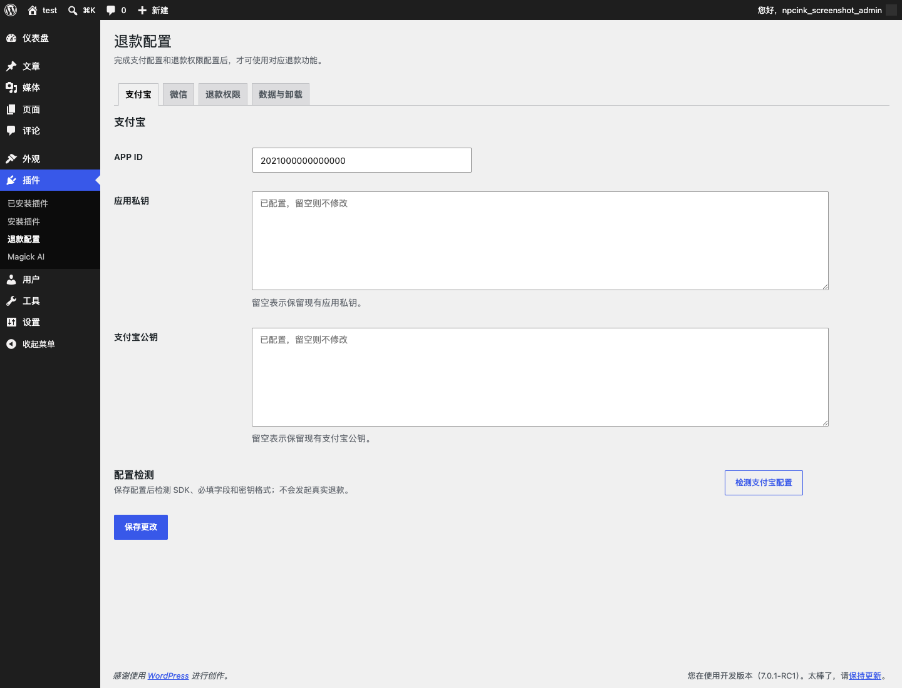
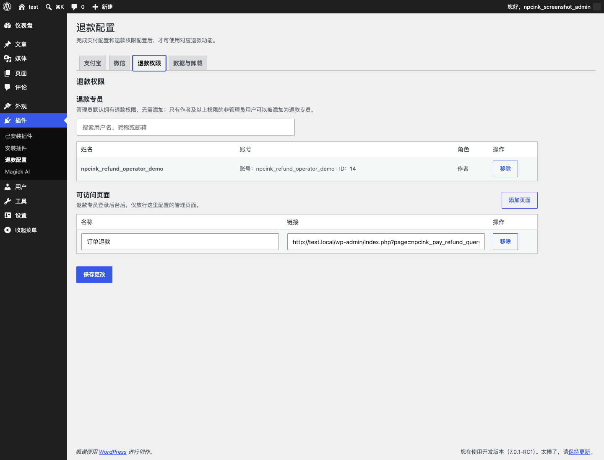
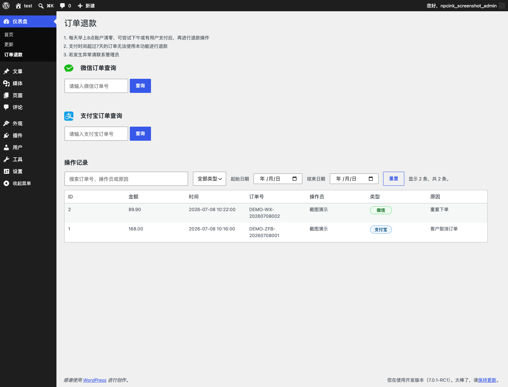
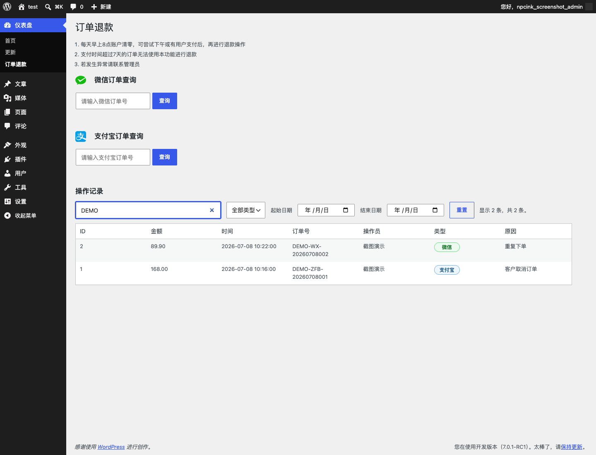

# Npcink Pay Refund 中文指南

这是一个 WordPress 后台退款工具。它查询已有的支付宝、微信支付订单，对符合条件的订单发起全额退款，并记录结果；不创建支付、不处理支付通知、不修改第三方订单状态。

## 版本与安装

- **稳定版 1.3.10**：从 WordPress.org 安装或使用 GitHub 正式版附件。支付宝、微信商户验收仅适用于原发布包，见[正式发布记录](RELEASE-1.3.10.zh-CN.md)。
- **预发布 1.3.11**：仅在 GitHub 提供验收包，尚未发布到 WordPress.org。桌面 Excel 和两渠道商户验收仍待完成，见[预发布记录](RELEASE-1.3.11.zh-CN.md)。
- 需要 WordPress 6.0 和 PHP 8.1 或更高版本。不要直接安装 GitHub 自动生成的源码包，其中可能缺少支付 SDK 所需的 Composer 依赖。

## 后台入口

- **插件 → 退款配置**（`plugins.php?page=npcink_pay_refund_config`）：管理员配置支付渠道和退款专员权限。
- **仪表盘 → 订单退款**（`index.php?page=npcink_pay_refund_query`）：查询、退款和查看记录。管理员看全部，退款专员只看自己的记录和待处理状态。

## 开发与验证

| 命令 | 用途 |
| --- | --- |
| `composer install` | 安装本地开发依赖。 |
| `composer test` | 运行本地 PHP 回归，不调用真实支付网关。 |
| `composer verify:local` | 本地门禁，含依赖审计、回归和 ZIP 清单检查，不验证 WordPress/MySQL 集成。 |
| `composer verify` | 完整门禁，须明确设置 `WP_PATH` 并使用带 `.npcink-refund-test-site` 标记、安装了 Plugin Check 的隔离站点。 |
| `composer build:zip` | 生成带 Composer 运行依赖的安装包 `build/npcink-pay-refund-版本号.zip`。 |

两个 `verify` 命令都会构建 ZIP，可能覆盖同版本制品；有冻结包时使用独立 checkout。商户验收不由这些命令替代，操作要求见[开发与发布规范](DEVELOPMENT-AND-RELEASE-STANDARDS.zh-CN.md)和[商户联调清单](REFUND-INTEGRATION-CHECKLIST.md)。

## 代码地图

| 要找什么 | 从哪里开始 |
| --- | --- |
| 插件启动、微信加载 | [插件主文件](../npcink-pay-refund.php)在后台分支单独加载并启动微信；[Admin 组装器](../admin/class-npcink-pay-refund-admin.php)组装其余后台模块。 |
| 后台页面、权限、操作日志、卸载 | [admin/partials/](../admin/partials/) 放的是查询、配置、权限、操作日志和卸载模块，并非视图碎片。 |
| 渠道查询、退款、状态确认 | [支付宝](../admin/pay/npcink-pay-refund-admin-zfb.php)和[微信](../admin/pay/npcink-pay-refund-admin-wx.php)各自封装对应渠道。 |
| 订单锁、退款记账与对账 | [Admin_Public](../admin/pay/npcink-pay-refund-admin-public.php)是两渠道共用的后台逻辑，不是前台模块；[Activator](../includes/class-npcink-pay-refund-activator.php)负责表结构。 |
| 后台样式 | 实际加载 [CSS](../admin/css/npcink-pay-refund-admin.css)；当前构建不编译 Less。 |

## 后台截图

以下是早期界面示意，当前布局和控件可能不同。

### 支付宝配置与检测

### 退款专员权限

### 退款操作台与近期记录

### 退款记录搜索与筛选

## 维护文档

- [1.3.10 审查处置、开发复盘与原候选验收](CLOSEOUT-AND-RETROSPECTIVE-1.3.10.zh-CN.md)
- [1.3.10 正式发布与制品核对记录](RELEASE-1.3.10.zh-CN.md)
- [退款审查后续维护与操作日志](AUDIT-FOLLOWUP.zh-CN.md)
- [1.3.11 维护候选：规模基准、限流设计与人工验收](MAINTENANCE-CANDIDATE-1.3.11.zh-CN.md)
- [1.3.11 GitHub 预发布：精确制品、核验与未完成事项](RELEASE-1.3.11.zh-CN.md)
- [1.3.9 收尾、剩余边界与开发复盘](CLOSEOUT-AND-RETROSPECTIVE-1.3.9.zh-CN.md)
- [1.3.9 正式发布与制品核对记录](RELEASE-1.3.9.zh-CN.md)
- [1.3.8 候选版的 22 项整改记录（历史）](AUDIT-REMEDIATION-1.3.8.zh-CN.md)
- [项目改造历史与当前状态](PROJECT-HISTORY.zh-CN.md)
- [1.3.1 开发复盘与维护思路](DEVELOPMENT-SUMMARY-1.3.1.zh-CN.md)
- [1.3.2 界面压缩与中文状态复盘](DEVELOPMENT-SUMMARY-1.3.2.zh-CN.md)
- [1.3.3–1.3.6 对抗式审查与发布工程复盘](DEVELOPMENT-RETROSPECTIVE-1.3.3-1.3.6.zh-CN.md)
- [WordPress.org 上架准备记录](WPORG-LISTING-PREP.zh-CN.md)
- [WordPress.org 1.3.5 审核与首次发布复盘](WORDPRESS-ORG-RELEASE-RETROSPECTIVE-1.3.5.zh-CN.md)
- [首次真实商户联调清单](REFUND-INTEGRATION-CHECKLIST.md)
- [开发与发布规范](DEVELOPMENT-AND-RELEASE-STANDARDS.zh-CN.md)

## 功能

- 可进行支付宝退款
- 可进行微信退款
- 每笔退款订单进行数据库记录，记录信息包含
  - 退款 ID
  - 退款金额
  - 退款时间
  - 退款订单号
  - 退款员工
  - 退款类型
  - 退款原因
- 仅限指定人员可退款
- 退款专员通过独立退款能力操作，不接管其余 WordPress 后台页面
- 支付密钥可通过 `wp-config.php` 常量注入，常量值优先于数据库配置且不会被设置页写回

## 请求与记录契约

- 两个查询框均接受**商户订单号 `out_trade_no`**，原样传入；不接受微信 `transaction_id` 或支付宝 `trade_no`，不自动猜测或改写。例如商户号为 `SHOP-20261105-001` 时输入该完整值。
- 支付宝 `sendPayDate` / `gmtRefundPay` 的无时区时间按 `Asia/Shanghai` 解释；微信支付时间须为带时区的 RFC3339，允许小数秒并按整秒比较。退款窗口比较真实时间戳，展示时间转换到 WordPress 站点时区。支付时间缺失、无法解析或晚于当前时刻时不允许退款，但不显示为超期。
- 支付宝密钥支持完整 PEM 或纯 Base64，要求可解析的 RSA 2048 位及以上私钥/公钥；诊断只验证本地格式，不证明商户授权或密钥配对正确。
- 微信全额退款按原始订单总额提交；记录金额为 `payer_refund`（付款人实际收到的金额，允许为 0），不等同于包含优惠的商户退款总额。记录成功前须核对订单号、请求号、原始总额、全额退款金额和 CNY 币种；缺失或不匹配时保留上下文。
- 微信 UNKNOWN 只显示状态未知，不代表已受理；只有已验证的 PROCESSING 才显示通道处理中。支付宝退款查询须返回 `refundStatus=REFUND_SUCCESS` 且订单、请求号和金额全匹配，缺失/未知状态继续锁定。
- 新退款审计时间使用提供方退款成功时间；缺失时回退到本次提交时间。已有历史记录不自动改写。
- 管理员查看全部，退款专员查看自己的记录和待处理状态；无操作者 ID 的历史状态仅管理员可见。操作他人的待处理退款也被服务端拒绝。
- 记录列表每页 20 条，搜索在服务端执行。待处理状态按全局插入顺序逐批读取，每批最多 100 项、扫描最多 200 项，用“下一批”继续；无待处理项时隐藏区域，有状态或后续游标时显示默认折叠提醒，查询失败会展开重试提示。提醒数字仅表示当前首批可见状态，不代表全库总数。
- 同订单请求需要数据库 `GET_LOCK` 支持；获取失败会拒绝操作，不降级为无锁执行。两渠道发送退款请求前再次检查连接持锁状态，失锁时保留原上下文并停止提交。持久化锁以令牌和 CAS 接管/释放。关闭状态保留轻量终态凭据和下一尝试号，卸载清理配置时一并删除。
- 部署前按开发规范运行 `bin/check-database-locks.php`：业务读写和命名锁须使用同一可写数据库连接。预检仅证明所观察的连接，连接代理或读写路由变化后须重跑；数据库与支付平台之间不存在原子事务，发送后断线仍须按原请求号查询恢复。

## 后台入口展示

- 订单查询和当前退款结果始终直接展示；未知结果、处理失败与补记失败不会藏进折叠区域。
- 待处理详情默认折叠；查询页不重复显示全局通知，其他后台页面仍保留一行待核对提醒。通过通知链接进入时自动展开。
- 记录搜索保留在外，渠道/日期收进“更多筛选”，折叠后仍显示启用条件数；仅多页时展示分页。
- 已保存密钥只显示“已配置 · 更换密钥”，点击展开空白输入框；首次配置自动展开，留空保留原值。折叠不会清空或禁用表单字段。
- 旧版链接记录、运行说明和卸载数据选项默认折叠；卸载摘要显示保存的清理选择。未保存清理选择时保留记录、配置和密钥，既有选择不自动变更。配置检测通过时明细折叠，失败时明细展开。

## 历史与联系

版本演进见[项目历史](PROJECT-HISTORY.zh-CN.md)和[插件更新记录](../readme.txt)；旧版中文更新日志保留在[历史快照](https://github.com/npcink/npcink-pay-refund/blob/db47f4d08ef29b61e900e6ee0fc670149c1336a1/docs/README.zh-CN.md#更新记录)。

插件免费；项目联系 QQ：1355471563。
